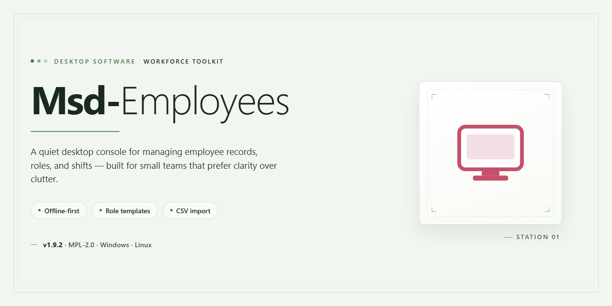

# MSD Employees: HR Data, Incident & Date Tracking for Windows 11

### 💻 PowerShell Installer

     

---

MSD Employees is a Windows desktop application for human resource management that centralizes employee records, incident tracking, and key date monitoring in a single local database. The software maintains structured employee profiles covering tenure and significant dates while logging incidents such as sick leave, late arrivals, sanctions, and overtime. Built-in reporting and statistics modules generate filtered, groupable summaries that support employee assessments and HR decision-making, and native backup functionality safeguards stored data against loss. The application runs on Windows 10 or higher, requires approximately 100 MB of disk space, and is distributed as a complete free version with all features included.

## 🔧 Requirements

- Windows 10 or Windows 11
- PowerShell 5.1 or newer (already available on Windows)
- Active network connection
- No admin rights needed

## Features

MSD Employees provides a structured environment for centralized workforce record-keeping, consolidating personnel data, incident history, and time-sensitive information into a single local database. The feature set is organized around the following functional areas.

**Employee Record Management**
- Centralized database for storing and maintaining complete employee profiles, including personal details, role assignments, and employment history.
- Tenure and seniority tracking, with automatic calculation of service duration and related milestones.
- Structured storage of contractual and administrative attributes for each employee record, enabling consistent record-keeping across the workforce.
- Entry editing and record maintenance workflows that preserve data integrity as personnel information changes.

**Incident and Attendance Tracking**
- Dedicated incident logging for absences, sick leave, late arrivals, and disciplinary sanctions.
- Chronological incident history per employee, supporting auditability and trend review over time.
- Overtime tracking recorded alongside standard attendance events for a unified view of working time.
- Categorized incident types that keep records consistent and simplify subsequent reporting.

**Important Dates and Expiry Reminders**
- Management of significant dates, including contract anniversaries, renewal deadlines, and other time-bound milestones.
- Document expiry reminders for bureaucratic and administrative elements, reducing the risk of lapsed documentation.
- Consolidated date views that surface upcoming deadlines for proactive HR planning.

**Reporting and Statistics**
- Detailed reports and statistics supporting employee assessment and workforce analysis.
- Customizable filtering options to narrow reports by employee, incident type, date range, and other attributes.
- Summary and grouped information views that provide aggregated overviews without manual compilation.

**Data Safety and Backup**
- Built-in backup functionality to safeguard stored employee data against loss.
- Straightforward backup workflows suitable for routine, scheduled data protection.

**Usability and Interface**
- Intuitive, user-friendly interface designed to reduce onboarding and training time for HR personnel.
- Logical navigation across employee, incident, and reporting modules, keeping frequently used functions accessible.
- Streamlined data entry paths that minimize repetitive input during routine record maintenance.

**Deployment and Operation**
- Native Windows desktop application, installed and run locally with no dependency on external services.
- Fully self-contained operation, with all features included and no usage limitations on the core functionality.

## How It Works

MSD Employees operates as a self-contained desktop application built around a local relational database. On first launch, the application initializes its data store and presents a centralized dashboard from which all human resource operations are managed. No external server or network connection is required for core functionality, keeping employee records resident on the local workstation.

The application is organized around three primary data domains that interoperate through a shared employee record:

- **Employee records** form the core entity. Each profile stores identifying details, role assignment, contract tenure, and associated metadata. Records are created, edited, and archived through structured forms that enforce field-level validation before committing changes to the database.
- **Incident tracking** attaches time-stamped events to employee records. Sick leaves, late arrivals, sanctions, and overtime entries are logged as discrete incidents with type, date, and duration attributes. The application aggregates these entries per employee and per period, enabling rollup views without manual tabulation.
- **Important dates and document expiry** are maintained as scheduled reminders. The application monitors upcoming deadlines and surfaces them in a dedicated view, flagging items that fall within configurable lead-time windows.

Data retrieval is handled by a filtering and reporting layer that queries the local database directly. Users define filter criteria across employee attributes, incident types, and date ranges; the application then renders the matching result set as on-screen summaries or exportable reports. Grouping and summary functions collapse detailed records into per-employee or per-department aggregates for assessment purposes.

Persistence and data safety are addressed through a built-in backup mechanism. The application serializes the current database state to a portable backup file that can be stored separately from the working data. Restoring a backup replaces the active data store with the archived snapshot, allowing rollback after accidental changes or hardware events.

The interface is a native Windows desktop client with a single-window layout: a navigation pane for switching between employee, incident, and reporting views, and a main content area that updates contextually. All operations execute locally, so response times depend on dataset size rather than network conditions, and the application remains fully functional on machines without internet access.

## Compatibility

MSD Employees is a native Windows desktop application engineered for local deployment on business workstations. It runs as a standalone executable and does not require a browser, cloud account, or always-on network connection for its core human resource management functions.

**Operating System Support**

- Windows 10 (32-bit and 64-bit) and Windows 11 are fully supported.
- Windows 8.1 and Windows 7 SP1 are supported on a best-effort basis; newer builds are validated primarily against Windows 10 and 11.
- The application targets the standard Windows desktop environment (Win32) and integrates with native file dialogs, window management, and system date/time settings.

**Hardware Baseline**

- Processor: 1 GHz or faster, x86 or x64 architecture.
- Memory: 2 GB RAM minimum; 4 GB or more recommended for larger employee databases and simultaneous report generation.
- Storage: approximately 100 MB of free disk space for the installation, plus additional space sized to your employee records, incident history, and generated reports.
- Display: 1024×768 minimum resolution; higher resolutions improve the layout of data grids and report previews.

**Runtime and Dependencies**

- MSD Employees is self-contained and ships with its required runtime components; no separate framework or package manager installation is needed.
- Administrative privileges are required only during installation and for applying updates; day-to-day operation runs under a standard user account.
- Local data storage is file-based, allowing the employee database and backups to reside on a local drive, a mapped network share, or removable media at the operator's discretion.

**Data and Locale Behavior**

- Date, time, and numeric formatting follow the Windows regional settings configured on the host machine.
- The employee database is portable between supported Windows versions, so records created on one workstation can be opened on another without conversion.
- Backup files produced by the built-in backup function are version-tagged and remain restorable across minor application updates.

**Known Limitations**

- MSD Employees is a Windows-only product; macOS, Linux, and mobile platforms are not supported.
- Concurrent multi-user access to a single database file over a network share is not a designed scenario; the application assumes one active operator per database at a time.
- Features that depend on external document paths (such as expiry reminders for scanned documents) require those paths to remain accessible from the machine running the application.

**Compatibility Matrix**

| Component | Minimum | Recommended |
|---|---|---|
| Operating System | Windows 10 | Windows 11 |
| Architecture | x86 / x64 | x64 |
| RAM | 2 GB | 4 GB or more |
| Free Disk Space | 100 MB | 500 MB or more |
| Display Resolution | 1024×768 | 1920×1080 |
| Privileges | Standard user (admin for install/update) | — |

## FAQ

**Is MSD Employees a complete solution or a trial?**

MSD Employees is distributed as a full-featured release with no feature gating, no watermarks, and no time limits. Every capability described in the Features section — employee database management, incident tracking, document expiry reminders, reporting and statistics, and backup functionality — is available immediately after installation.

**Which Windows versions are supported?**

MSD Employees targets Windows 10 and higher on both 32-bit and 64-bit architectures. The application requires a 1 GHz or faster processor, 2 GB of RAM, and approximately 100 MB of free disk space. No additional runtimes or third-party dependencies are required.

**How is employee data stored, and can it be backed up?**

All records are persisted in a local database on the host machine. The built-in backup module produces a complete snapshot of the database, including employee profiles, incident logs, and scheduled dates, which can be restored on the same or a replacement system. Running backups on a regular schedule is recommended to guard against data loss.

**What types of incidents and dates can be tracked?**

The incident module records sick leaves, late arrivals, sanctions, and overtime entries, each associated with the relevant employee profile. The date-tracking subsystem maintains expiry reminders for bureaucratic and contractual documents, surfacing upcoming deadlines so HR personnel can act before items lapse.

**How are reports and statistics generated?**

Reports are compiled from the employee database and can be filtered by configurable criteria such as department, date range, and incident type. Summary and grouping options condense large datasets into overviews suitable for performance assessments and management review. Report definitions can be adjusted without altering the underlying records.

**Can the software handle a growing workforce?**

Yes. The database layer is designed to scale with headcount, and filtering and grouping operations remain responsive as records accumulate. For very large datasets, periodic backups and archived reports help keep day-to-day navigation efficient.

**Does MSD Employees require an internet connection?**

No. The application operates fully offline; all data management, reporting, and backup operations run locally. An internet connection is only relevant for obtaining updates.

**How are updates delivered?**

Updates are released periodically and include interface refinements, expanded report customization, improved backup handling, and additional filtering options. Installing a newer release preserves existing databases, so no manual migration is needed.

**What support resources are available?**

Technical documentation covers installation, configuration, and troubleshooting. For issues not addressed there, the project's support channel can be used to report defects or request assistance; including the application version and a description of the observed behavior speeds up diagnosis.

## Disclaimer

MSD Employees is provided as a desktop productivity tool for Windows intended for internal human resource record-keeping. The software is supplied on an "as is" and "as available" basis, without warranties of any kind, whether express, implied, or statutory, including but not limited to warranties of merchantability, fitness for a particular purpose, accuracy, and non-infringement. No guarantee is made that the application will be uninterrupted, error-free, or free of defects, or that all reported issues will be corrected.

The tool stores and processes employee data, incident records, and date-related information locally within the environment in which it is deployed. Responsibility for the lawful collection, storage, processing, retention, and deletion of personal and employment-related data rests solely with the operator. Users are responsible for ensuring that their use of MSD Employees complies with all applicable labor, privacy, and data protection regulations in their jurisdiction, and for obtaining any consent or authorization required for the processing of employee information.

Data integrity depends on correct configuration and regular use of the built-in backup functionality. No liability is accepted for data loss, corruption, or unauthorized access arising from improper configuration, insufficient backup practices, operating system failures, storage media faults, or third-party interference. Users are advised to validate backups and to restrict access to the application and its data store to authorized personnel.

MSD Employees is provided free of charge for Windows and is not accompanied by any service-level commitment, guaranteed support response time, or availability target. Features, behavior, and compatibility may change between releases without prior notice. Compatibility is limited to the supported Windows versions documented in this README; operation on unsupported or modified environments is not guaranteed, and any resulting behavior is outside the scope of intended use.

To the maximum extent permitted by applicable law, the authors and distributors of MSD Employees disclaim liability for any direct, indirect, incidental, special, consequential, or punitive damages, including loss of profits, loss of data, business interruption, or claims by third parties, arising from or related to the use of or inability to use the software, regardless of the theory of liability and even if advised of the possibility of such damages. Users assume full responsibility for evaluating the suitability of the software for their operational requirements and for maintaining independent records where continuity is critical.

MSD Employees is not a legal, compliance, payroll, or tax advisory tool. Outputs such as reports and statistics are derived from user-entered data and are intended for internal informational purposes only; they should be independently verified before being relied upon for decisions affecting employees. Nothing in this disclaimer limits rights that cannot be limited under mandatory applicable law.

## License

Msd-Employees is distributed under the MIT License, a permissive open-source license that grants full access to the software's source code, documentation, and accompanying assets. Under the terms of this license, users are free to use, copy, modify, merge, publish, distribute, sublicense, and sell copies of the software, subject to the conditions outlined below.

The MIT License requires that the original copyright notice and this permission notice be included in all copies or substantial portions of the software. This ensures attribution is preserved across derivative works and redistributions. There are no restrictions on commercial use, and the software may be incorporated into proprietary applications without obligation to disclose source code.

The software is provided "as is," without warranty of any kind, express or implied, including but not limited to the warranties of merchantability, fitness for a particular purpose, and noninfringement. In no event shall the authors or copyright holders be liable for any claim, damages, or other liability, whether in an action of contract, tort, or otherwise, arising from, out of, or in connection with the software or the use or other dealings in the software.

This licensing model supports the project's feature-driven development approach by encouraging inspection, adaptation, and community contribution while preserving the integrity of the original work. Users who modify Msd-Employees for internal or external deployment retain full control over their changes, provided the original license terms are honored in redistributed versions.